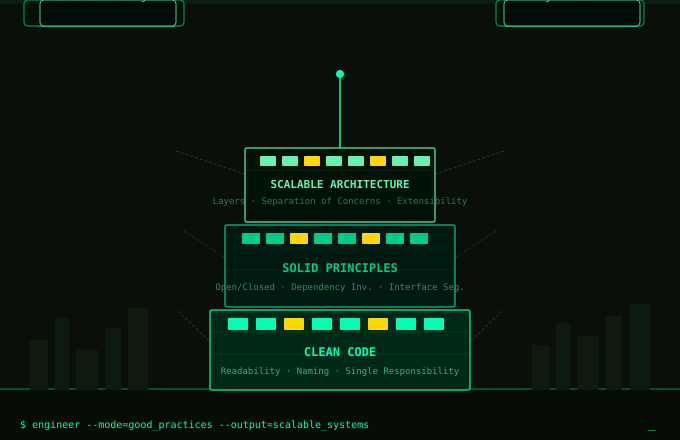

<div align="center">


<a href="https://git.io/typing-svg"></a>

<br/>

<a href="https://github.com/samuelxe2?tab=repositories"></a>

<a href="https://github.com/samuelxe2?tab=followers"></a>


</div>

---

## 身元 &nbsp;·&nbsp; About

I'm a **backend developer and systems engineer** who cares about the parts of software nobody sees but everybody depends on: data pipelines, APIs, and the architecture that holds them together. My background spans backend services, data engineering, cloud integration and CS fundamentals (operating systems, algorithms, logic and functional programming, model-driven engineering).

<table>
<tr>
<td width="50%" valign="top">

**What I'm focused on**

- 🔧 Building **ETL pipelines** in Python with **Polars**
- 🏗️ Designing **REST APIs** with Laravel and FastAPI
- ☁️ Integrating services on **Microsoft Azure**
- 🧠 Applying **OS, algorithms & MDE** to real systems

</td>
<td width="50%" valign="top">

```python
class Engineer:
    handle = "samuelxe2"
    focus  = ["Backend", "Data Eng",
              "Cloud", "Architecture"]
    values = ["Collaborative",
              "Adaptive", "Pragmatic"]
    goal   = "Continuously improve the "
             "quality of the systems I build."
```

</td>
</tr>
</table>

---

## 武器庫 &nbsp;·&nbsp; Tech Stack

<div align="center">


<br/><sub><b>Languages</b> &nbsp;·&nbsp; PHP · Python · TypeScript · JavaScript · Java · Haskell · SQL · Prolog</sub>

<br/><br/>


<br/><sub><b>Frameworks · Cloud · Tooling</b> &nbsp;·&nbsp; Laravel · FastAPI · React · Polars · Azure · Docker · Linux · Git</sub>

<br/><br/>


</div>

---

## 技術地図 &nbsp;·&nbsp; Skill Map

<div align="center">
  
</div>

---

## 任務 &nbsp;·&nbsp; Featured Projects

> Ordered by architectural complexity.

### ◈ Tier III — Complex architecture

<a href="https://github.com/samuelxe2/metamodelo_metametamodelo">
  
</a>

**⚡ [metamodelo_metametamodelo](https://github.com/samuelxe2/metamodelo_metametamodelo)** &nbsp;`TypeScript` `MDE`
<br/>A four-level modeling stack (M3 → M0) applying Model-Driven Engineering principles: meta-metamodel definition, metamodels, and conformance between layers.

<br/>

<a href="https://github.com/samuelxe2/ACO_Server_Routing">
  
</a>

**🐜 [ACO_Server_Routing](https://github.com/samuelxe2/ACO_Server_Routing)** &nbsp;`Python` `Graphs` `Metaheuristics`
<br/>Ant Colony Optimization applied to server routing: agents deposit pheromone on low-latency links until the colony converges on the best route.

<br/>

<a href="https://github.com/samuelxe2/mini_os">
  
</a>

**🖥️ [mini_os](https://github.com/samuelxe2/mini_os)** &nbsp;`Python` `OS theory`
<br/>A layered operating-system simulator: boot sequence, system calls, Round-Robin and priority scheduling, and paged memory allocation.

### ◈ Tier II — Functional systems

| Project | Stack | Description |
|:--|:--|:--|
| 🔍 [**scanner**](https://github.com/samuelxe2/scanner) | `Python` | Network analysis and port scanning |
| ⚙️ [**SimuladorPlanificacion**](https://github.com/samuelxe2/SimuladorPlanificacion) | `Python` | CPU scheduling simulator — FCFS · SJF · RR |
| 🌐 [**interfaceBD**](https://github.com/samuelxe2/interfaceBD) | `TypeScript` | Database management UI |
| 💧 [**simulacion_agua**](https://github.com/samuelxe2/simulacion_agua) | `Python` | Numerical fluid simulation |
| 📡 **wan_tramas** · **teleinformatica2** | — | WAN frames and telecom coursework |

<details>
<summary><b>◈ Tier I — Modules &amp; utilities</b> &nbsp;<sub>(click to expand)</sub></summary>

<br/>

| Project | Stack | Description |
|:--|:--|:--|
| 🃏 **BlackJack-Recursivo** | `Python` | Blackjack implemented using recursion only |
| 🧮 **probabilidad-final** | `Python` | Least squares and probabilistic models |
| λ **Ejercicios-practicos-haskell** | `Haskell` | Functional programming exercises |
| 🧠 **Nomina-prolog** · **familia** | `Prolog` | Declarative logic systems |
| 🧩 **laberinto** | `Prolog` | Maze solving with logic rules |

</details>

---

## 統計 &nbsp;·&nbsp; GitHub Stats

<div align="center">


<br/><br/>


<br/>

<picture>
  <source media="(prefers-color-scheme: dark)" srcset="https://raw.githubusercontent.com/samuelxe2/samuelxe2/output/snake-dark.svg"/>
  
</picture>

</div>

---

## 道 &nbsp;·&nbsp; The Way

<div align="center">



*Build systems that endure — clean architecture outlasts any single feature.*

</div>

---

## 通信 &nbsp;·&nbsp; Contact

<div align="center">

<a href="https://github.com/samuelxe2"></a>

<a href="[https://www.linkedin.com/in/YOUR-PROFILE](https://www.linkedin.com/in/samuel-s%C3%A1nchez-pe%C3%B1a-27a063144/)"></a>
<a href="mailto:samuelantoniosanchez13@gmail.com"></a>

<br/><br/>


</div>
